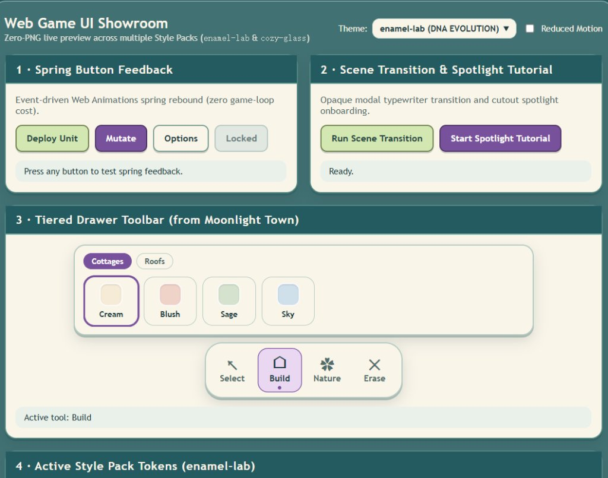
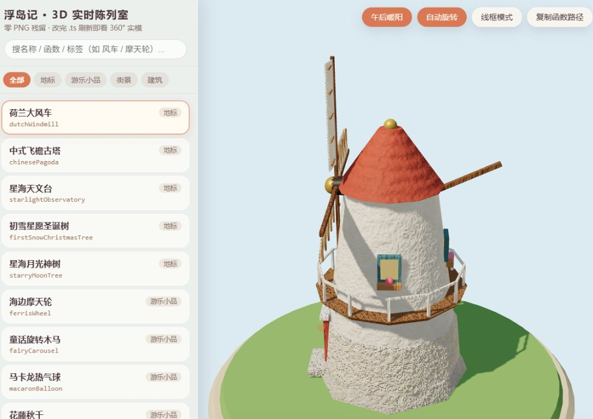

# Awesome Extracting Asset Skill

[中文说明](./README.zh.md)

**Turn finished games & projects into searchable, style-decoupled AI Agent Skills — zero context bloat, zero PNGs.**

`extracting-asset-skill` is an open-source **Meta-Skill** for AI coding agents (Claude Code, Antigravity, Cursor, Codex, etc.) that extracts reusable technical and creative assets from any finished project—procedural 3D/2D models, shaders, UI primitives, audio engines, or effect libraries—into a clean, searchable, style-decoupled **Agent Skill**.

---

## Showcase (Real Outputs Extracted from 3 Indie Web Games)

> **Note:** Screenshots below are for this README only. Inside the generated Skills themselves, **zero `.png` thumbnails are stored**—humans browse live interactive HTML showrooms while AI agents query JSON indexes.

| Web Game UI Showroom (Multi-Theme Live Switcher) | Procedural 3D Showroom (44 Three.js Assets) |
| :---: | :---: |
|  |  |
| *Extracted from DNA EVOLUTION & Moonlight Town (`enamel-lab` + `cozy-glass`)* | *Extracted from Drift Diary (44 vertex-colored Three.js assets, zero UVs)* |

---

## Before vs. After

| Pain Point | Pointing AI to an Old Repo | Using `extracting-asset-skill` |
| :--- | :--- | :--- |
| **Context Window** | AI scans 30+ files and burns half its context before coding | AI runs `search_assets.py` and reads only the matched `#Lline` block |
| **Style Lock-In** | Colors, proportions, and old game glue (`i18n`, `battle`) leak into new games | Decoupled **Universal Base (`templates/`)** + swappable **Style Packs (`styles/<id>/`)** |
| **Visual Browsing** | Either no preview or dozens of stale `.png` files bloating the Skill | Live **Zero-PNG Showroom (`showroom/gallery.html`)** importing real source code |
| **Cross-Project Reuse** | Duplicated skills or broken imports across games | Incremental merge into one domain Skill + `--sync-lines` validation |

---

## How It Works

```text
Old Game Repo ──▶ [Step 0: Silent Scan & 4-Question Alignment Gate]
                       │
                       ├──▶ Skip Project Glue (save/story/SDK)
                       │
                       ├──▶ templates/ ("style": "universal", stripped imports)
                       ├──▶ styles/<id>/ (palette, CSS tokens, post-processing)
                       ├──▶ assets-catalog.json + scripts/search_assets.py (--sync-lines)
                       └──▶ showroom/gallery.html (Zero-PNG live browser preview)
```

### Real CLI Output Example

```bash
$ python scripts/search_assets.py --q spring
Matched 2 UI asset(s):
- [interaction | universal] 弹簧按钮按压反馈 (Event-Driven Spring Button Feedback) -> templates/core/button-feedback.js#L4 `initializeButtonFeedback`
    Zero game-loop overhead spring press/rebound micro-interaction using Web Animations API with reduced-motion and keyboard support.
```

---

## Installation

### Option 1: Ask your AI Agent directly
Send this prompt to any Agent that supports `SKILL.md`:

```text
Install the skill from this repository: https://github.com/elysianx138/awesome-extracting-asset-skill
```

### Option 2: Manual install
Copy `skills/extracting-asset-skill/` into your agent's skills directory:
- **Workspace (Antigravity / Codex / Universal)**: `.agents/skills/extracting-asset-skill/`
- **Claude Code (Global)**: `~/.claude/skills/extracting-asset-skill/`

### Option 3: Sync to a Central Asset Vault
```bash
python skills/extracting-asset-skill/scripts/pack_and_sync_skill.py \
  skills/extracting-asset-skill \
  --target "~/game-asset-vault"
```

---

## Quick Usage

Once installed, simply prompt your coding agent:

```text
Use extracting-asset-skill to extract reusable UI primitives and theme tokens from ./my-previous-game
```

Or merge a second game's visual style into an existing domain Skill:

```text
Use extracting-asset-skill to extract the frosted-glass theme and drawer toolbar from ./game-2 and merge them into my existing building-web-game-ui skill
```

---

## Repository Structure

```text
skills/extracting-asset-skill/
├── SKILL.md                           # Main workflow & Step 0 alignment gate (< 80 lines)
├── references/
│   ├── style-pack-pattern.md          # Universal Base + Style Pack & Zero-PNG Showroom architecture
│   └── skill-spec-checklist.md        # Token economy & SKILL.md spec checklist
├── scripts/
│   └── pack_and_sync_skill.py         # Multi-target sync (--target) & POSIX ZIP packager
└── templates/
    ├── search_assets.py               # Domain-agnostic catalog search & --sync-lines CLI
    └── style.json                     # Starter Style Pack metadata template
```

## License

MIT License — see [LICENSE](./LICENSE).
