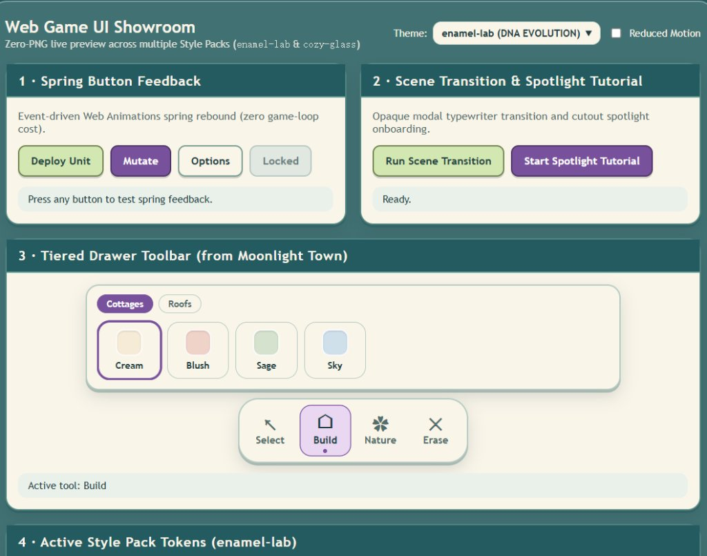
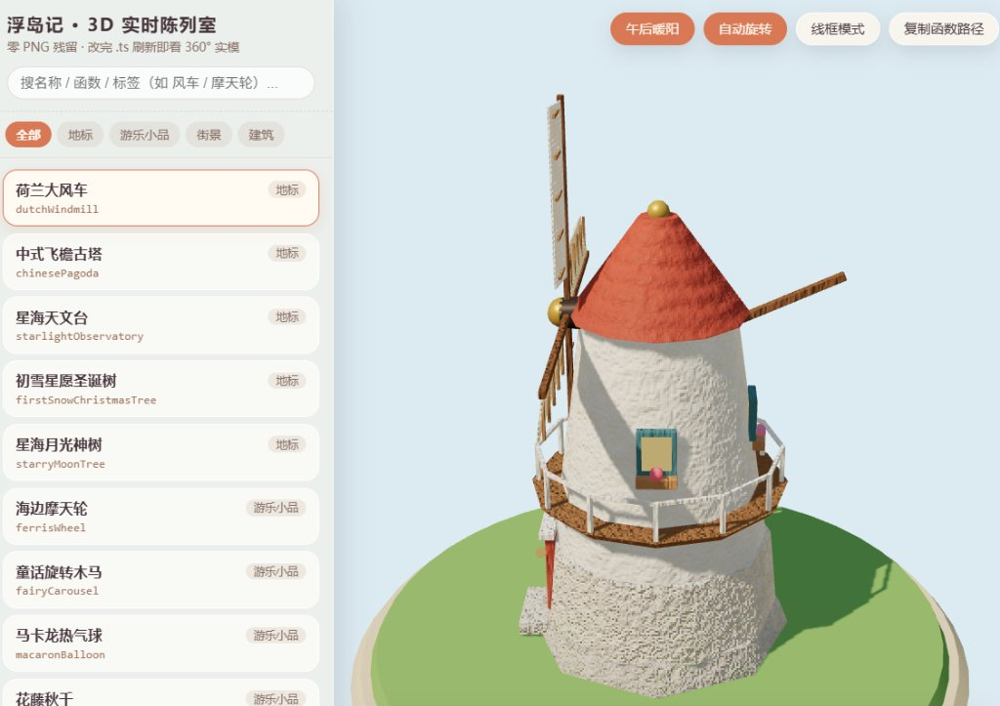

# Awesome Extracting Asset Skill

[English](./README.md)

**把做完的游戏/项目抽成底座与皮肤分离、行号级检索、零 PNG 实时陈列室的 AI Agent Skill。**

`extracting-asset-skill` 是一个面向 AI 编程助手（Claude Code、Antigravity、Cursor、Codex 等）的开源 **元技能（Meta-Skill）**。它能把任意做完的游戏或创意项目里的可复用资产（程序化 3D/2D 模型、Shader、UI 交互骨架、音效引擎、特效库），标准化抽成**可精准检索、底座与皮肤解耦、带零图片实时陈列室**的 Agent Skill。

---

## 实战效果展示（从 3 款独立 Web 游戏中真实抽离）

> **说明**：下方截图仅用于 README 展示；抽出来的 Skill 目录内部**不存任何 `.png` 缩略图**——人看实时交互网页，AI 只查 JSON 行号索引。

| Web 游戏 UI 陈列室（支持一键实时换肤） | 程序化 3D 资产陈列室（44 个 Three.js 组件） |
| :---: | :---: |
|  |  |
| *抽自《DNA EVOLUTION》与《月光小镇》（`enamel-lab` + `cozy-glass` 双皮肤）* | *抽自《浮岛记》（44 个无 UV 顶点色 Three.js 资产）* |

---

## 对比：直接喂旧仓库 vs. 使用 `extracting-asset-skill`

| 痛点 | 直接让 AI 读旧项目 | 使用 `extracting-asset-skill` |
| :--- | :--- | :--- |
| **上下文消耗** | AI 盲扫几十个文件，还没写新代码 Token 先烧掉一半 | AI 跑一句 `search_assets.py`，只读命中的 `#L行号` 代码块 |
| **风格与业务耦合** | 配色、比例与旧游戏逻辑（`i18n`、战斗状态）全粘在一起 | 强制拆分**通用底座（`templates/`）** + **可插拔皮肤（`styles/<id>/`）** |
| **视觉预览** | 隔半年忘了模型长啥样，塞 `.png` 截图又会把包体撑爆 | **零 PNG 实时陈列室（`showroom/gallery.html`）**，改完代码刷新即看 |
| **跨项目增量沉淀** | 每个游戏重复建库、互相冲突 | 按领域合并进同一资产库 + `--sync-lines` 校验行号 0 警告 |

---

## 核心工作流

```text
旧游戏项目 ──▶ [Step 0: 静默扫描 + 4 问对齐门控]
                   │
                   ├──▶ 自动跳过业务胶水（存档 / 剧情 / 渠道 SDK）
                   │
                   ├──▶ templates/（通用底座，剥离外部 import）
                   ├──▶ styles/<id>/（色板、CSS 变量、光照后期参数）
                   ├──▶ assets-catalog.json + scripts/search_assets.py（--sync-lines）
                   └──▶ showroom/gallery.html（零 PNG 浏览器实时陈列室）
```

### 终端检索实拍

```bash
$ python scripts/search_assets.py --q spring
Matched 2 UI asset(s):
- [interaction | universal] 弹簧按钮按压反馈 (Event-Driven Spring Button Feedback) -> templates/core/button-feedback.js#L4 `initializeButtonFeedback`
    Zero game-loop overhead spring press/rebound micro-interaction using Web Animations API with reduced-motion and keyboard support.
```

---

## 安装方式

### 方式一：直接让 AI Agent 安装
把下面这句话发给支持 `SKILL.md` 的 AI Agent：

```text
请帮我安装这个仓库里的 Skill：https://github.com/elysianx138/awesome-extracting-asset-skill
```

### 方式二：手动安装
将 `skills/extracting-asset-skill/` 复制到你的 Agent Skills 目录：
- **工作区级（Antigravity / Codex / 通用）**：`.agents/skills/extracting-asset-skill/`
- **Claude Code 全局**：`~/.claude/skills/extracting-asset-skill/`

### 方式三：同步到个人中央资产库
```bash
python skills/extracting-asset-skill/scripts/pack_and_sync_skill.py \
  skills/extracting-asset-skill \
  --target "~/game-asset-vault"
```

---

## 使用示例

提取旧项目的可复用资产：
```text
用 extracting-asset-skill 帮我把 ./my-previous-game 里的可复用 UI 交互骨架和视觉皮肤抽成一个 Skill
```

将第二款游戏的风格增量合并进已有资产库：
```text
用 extracting-asset-skill 把 ./game-2 的奶油磨砂风皮肤和抽屉工具栏，增量合并进现有的 building-web-game-ui 资产库
```

## 目录结构

```text
skills/extracting-asset-skill/
├── SKILL.md                           # 核心流程与 Step 0 对齐门控（< 80 行）
├── references/
│   ├── style-pack-pattern.md          # 底座+皮肤分离与零 PNG 陈列室架构说明
│   └── skill-spec-checklist.md        # Token 经济性与 SKILL.md 规范清单
├── scripts/
│   └── pack_and_sync_skill.py         # 多路径同步（--target）与 POSIX ZIP 打包工具
└── templates/
    ├── search_assets.py               # 领域无关的资产检索与 --sync-lines 校验 CLI
    └── style.json                     # 风格包元数据起始模板
```

## 开源协议

MIT License — 详见 [LICENSE](./LICENSE)。
